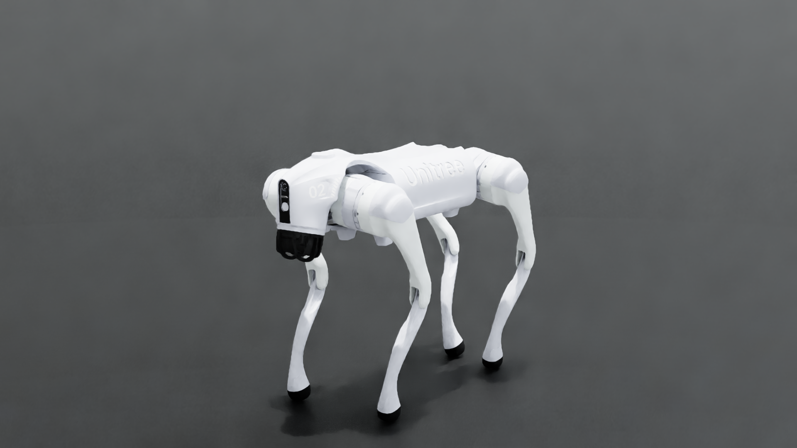
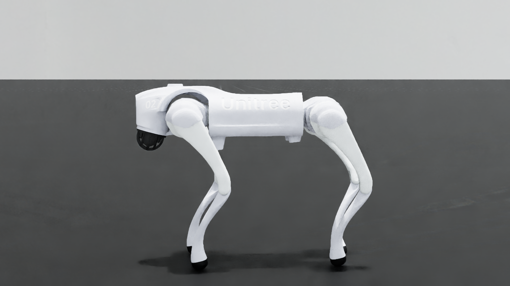
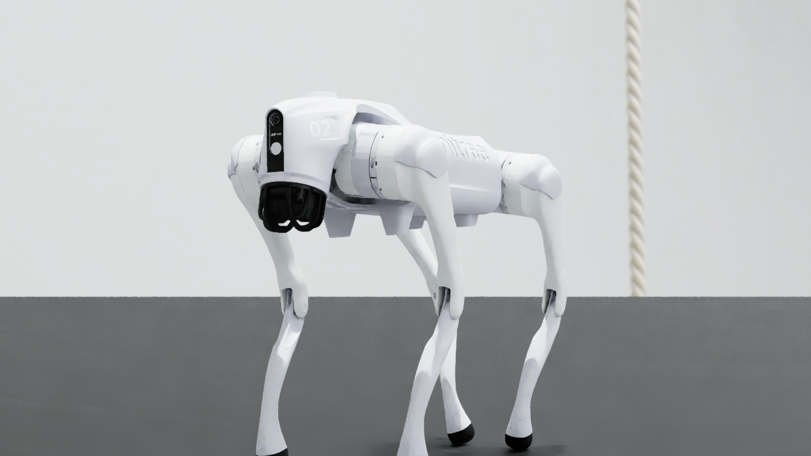

# Unitree Go2 – Isaac Sim digital twin

<p align="center">

</p>

Isaac Sim / Isaac Lab simulation of the Unitree Go2 (and G1) with a ROS 2 interface that mirrors the
real robot's topics, plus a **real-robot digital-twin mode** that drives the simulated joints from
the physical Go2's `/lowstate` stream.

- RL locomotion policies (rsl_rl) for flat / rough / stairs terrain, keyboard (WASD) or ROS 2 control
- ROS 2 publishers: camera, RTX lidar, IMU, odometry, joint states, foot force (real-Go2 topic names)
- Twin mode: IMU-aligned kinematic playback of the real dog ([docs/TWINBOT_IMU_FIX.md](./docs/TWINBOT_IMU_FIX.md))

<p align="center">
&nbsp;

</p>

## Reproducible environment (`env_isaaclab`)

| Component   | Version                                      |
|-------------|----------------------------------------------|
| Isaac Sim   | 4.5.0 (`nvcr.io/nvidia/isaac-sim:4.5.0`)     |
| Isaac Lab   | commit `b4c3210` (package 0.54.4)            |
| Python      | 3.10                                         |
| ROS 2       | Humble, `rmw_fastrtps_cpp`                   |
| Unitree msgs| `unitree_go`, `unitree_api` (pinned commit)  |
| RL          | `rsl-rl-lib` 5.0.1                           |

Everything is pinned in the [`Dockerfile`](./Dockerfile); the exact `pip freeze` of the original
conda env is in [`requirements.lock.txt`](./requirements.lock.txt).

### Requirements
- Ubuntu 22.04 / 24.04, NVIDIA RTX GPU, driver ≥ 535 (tested with 580)
- Docker + [NVIDIA Container Toolkit](https://docs.nvidia.com/datacenter/cloud-native/container-toolkit/latest/install-guide.html)
- ~40 GB free disk, X11 session for the GUI (the simulator imports `omni.ui`, so `--headless` is not supported)

### Run
```bash
git clone https://github.com/szonyibalazs/unitree_go2_isaacSIM_realtf.git
cd unitree_go2_isaacSIM_realtf
./run_container.sh            # builds the `env_isaaclab` image on first use, then starts Go2 on flat terrain
```
First start compiles shaders and downloads the default warehouse scene from NVIDIA's asset server (needs internet) – give it a few minutes. Control the dog with WASD.

More examples (everything after the script name goes to `main.py`):
```bash
./run_container.sh main.py --robot g1 --terrain flat          # Unitree G1
./run_container.sh main.py --list_envs                        # available environments
./run_container.sh main.py --capture 80 --enable_cameras \
    --rendering_mode quality --capture_dir ./media            # render hero stills
./run_container.sh bash                                       # shell inside the container
```
Manual build/run, if you prefer: `docker build -t env_isaaclab .` then see `run_container.sh`.

### ROS 2 side
The container uses host networking, so a host with ROS 2 Humble sees the topics directly:
```bash
export RMW_IMPLEMENTATION=rmw_fastrtps_cpp
ros2 topic list     # /utlidar/*, /lowstate, /camera/image_raw, ...
```
The sim listens on `/api/sport/request` for sport commands. `/tf`, `/odom`, `/joint_states` are
expected from the robot description launch, exactly as on the real robot.

### Digital twin of the real Go2
```bash
# on the robot's payload computer (Jetson, Humble):  python3 scripts/twinbot_bridge.py
./run_container.sh main.py --robot_amount 1 --robot go2 --terrain flat --twinbot --rendering_mode quality
```
Scope: **real → sim** (robot state into the twin) is implemented and IMU-aligned. Sim → real
commands use the standard Unitree SDK path; no closed learned loop is claimed.
Network layout and troubleshooting: [docs/TWINBOT_IMU_FIX.md](./docs/TWINBOT_IMU_FIX.md).

## Training
```bash
./run_container.sh train_stairs.py --headless   # training script does support headless
```
Checkpoints go to `logs/rsl_rl/<experiment>/<run>/`. The repo ships one checkpoint each for
Go2 rough, Go2 stairs and G1 rough; `main.py` loads the latest run found there.

## Native install (without Docker)
Install Isaac Sim 4.5.0 and Isaac Lab at commit `b4c3210`, create the conda env
(`conda env create -f environment.yml`), build `unitree_go`/`unitree_api` in a ROS 2 Humble
workspace and use `./run_sim_isaaclab.sh` (`GO2_WS` = that workspace).

## Custom environments
Large USD scenes are not stored in the repo. Put them in `envs/` and start with
`--custom_env <name> --terrain flat`; the first start takes a few minutes to prepare the scene.

## Repository layout
| Path | Purpose |
|------|---------|
| `Dockerfile`, `run_container.sh`, `docker/` | container build and launcher |
| `main.py`, `omniverse_sim.py` | simulator entry point, CLI, main loop |
| `ros2.py`, `omnigraph.py` | ROS 2 publishers/subscribers, camera graph |
| `custom_rl_env.py`, `stairs4.py`, `terrain_*.py`, `procedural_env.py` | RL environments and terrains |
| `twinbot.py`, `scripts/twinbot_bridge.py` | real-robot twin |
| `robots/g1/` | G1 asset and config |
| `data/sensors/lidar/` | Unitree L1 lidar config |

## License
BSD 2-Clause, see [LICENSE](./LICENSE).
